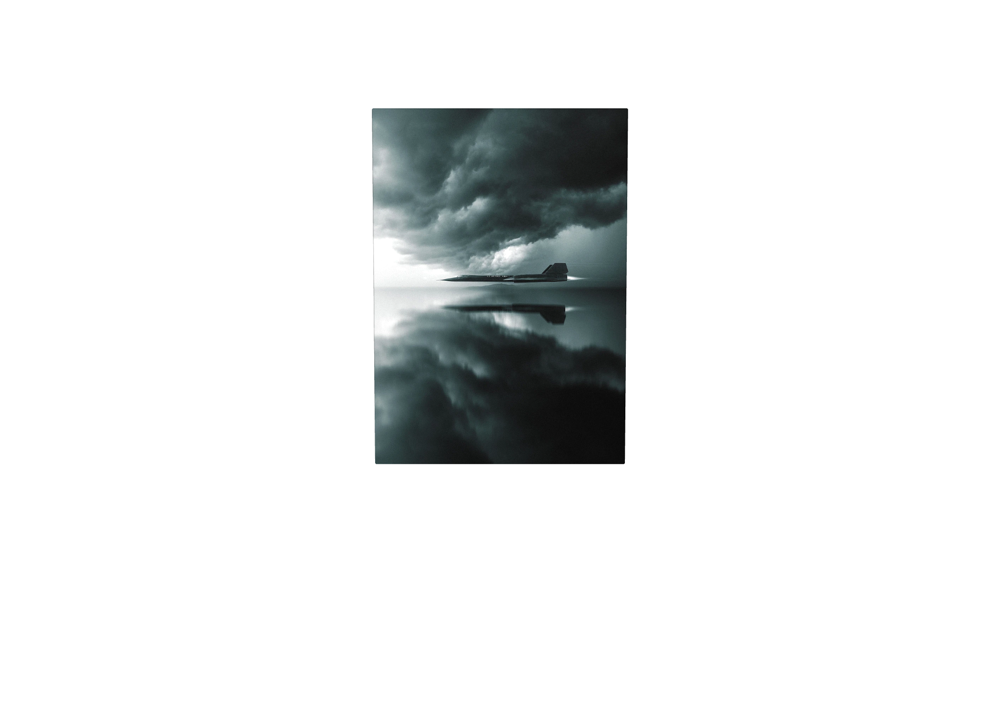
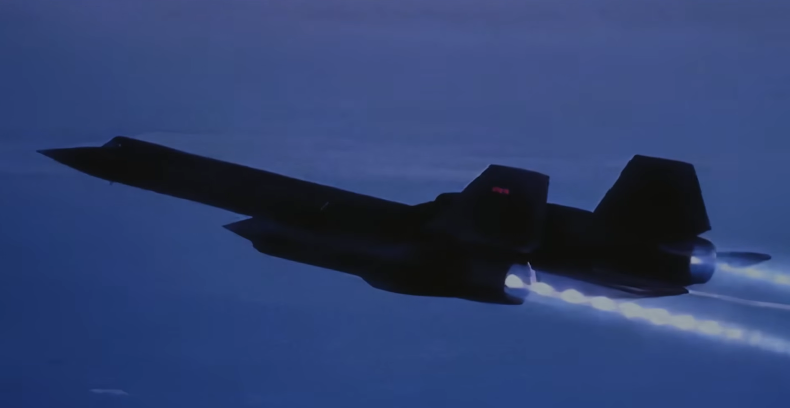

# Personal site concepts

An evolving list of intro concepts for hadsed.com. Each intro should lead into a simple, typography-focused personal site. Several intros could eventually rotate over time; the selection mechanism is undecided.

## Shared direction

- No visible text in the intro studies: no site name, captions, instructions, or calls to action. Visitors work out the interaction through the scene's response.
- Support scrolling, clicking, pointer movement, and touch where appropriate. Retain nonvisual accessibility labels and reduced-motion behavior.
- Use atmosphere, depth, and camera movement to invite exploration.
- Keep the eventual reading experience simple and markdown-like.
- Explore optimized Blender renders for convincing spatial scenes. The current browser studies explore motion and mood; they are not finished Blender scenes.

## Afterglow

### Scene

A first-person view of Southern California twilight: a space-like, dark purplish-blue sky meets the last small glow after sunset. This is the seam between day and night, with the feeling of a portal or a place where interesting things happen.

Explore pixelated, dithered, and smooth-gradient treatments. The palette moves from indigo and violet into dusty rose, peach, and subdued gold. There is no visible sun disk: the destination is the afterglow itself.

### Interaction

Scrolling or clicking moves the visitor toward the seam. The approach begins slowly and accelerates. As the camera gets closer, the glow spreads toward the edges and eventually overtakes the field of view. The original proposal was to morph this semi-orb of color into the header of a simple reading page.

The silent study currently stops inside the glow. The transition into real page content remains to be designed.

### Feedback to preserve

- Remove all visible text from the intro.
- Remove the static, floating mountain silhouettes from the first study.
- Explore a more convincing, web-optimized Blender-based environment rather than retaining those silhouettes.

### References

- [SoCal highway sunset](inspo/socal-405-sunset.jpg): pink-purple twilight and Ojai memories.
- [Pixel coastal road](inspo/pixel-coastal-road.png).
- [Ghibli-style clouds](inspo/pixel-ghibli-clouds.png).
- [Blake Cyze's referenced post](https://x.com/cyze_dev/status/2105719967328919792).
- [Cyze's CRT Screen Zoom explanation](https://www.cyze.dev/snippets/crt-screen-zoom): Blender renders 57 angles; the browser blends the nearest four, then a camera push hands off to the live page. This is a useful technique reference, not a requirement to reproduce his CRT scene.

## SR-71 / storm and reflection

### Source image

Had's metal-print poster reference shows an SR-71 in profile beneath heavy storm clouds, with a dark reflection below. The aircraft lies close to the seam between the storm and its mirrored world.

### Concept to explore

A second, independent intro: charcoal and blue-gray atmosphere, a dark aircraft silhouette, and a reflective plane. Preserve the image's stillness and tension. Keep the scene wordless.

The browser study tests a gentle response to pointer movement and an accelerating approach toward the aircraft and reflection. This is a photo-based motion study; a true change of viewing angle around the aircraft would require a model or additional rendered views.

### Open choices

- Does the camera approach the aircraft, skim the reflective surface, or pass through the reflection?
- Does the aircraft stay suspended, begin taxiing, or launch?
- How does this scene transition into the reading page?
- Use the poster image as an atmospheric reference for a Blender scene, or retain a photographic treatment?

### Camera routes and storyboard

Had proposed two camera moves: follow alongside the aircraft, climb over it, settle behind its afterburners, then watch it accelerate into the horizon; or begin head-on with a small aircraft against the storm, approach, retreat/rise as it closes, move to the side, and finish in the poster composition.

See [the two five-shot storyboards and editable Blender blockouts](sr71-storyboard.md). Had selected Route B, with the aircraft lower in the opening frame and a much larger, darker storm sky. The scene should feel epic in scale but quiet in activity: restrained cloud movement, minimal water, and no lightning spectacle. [The first Seedance camera draft and review](seedance-prototype.md) are saved; it follows the broad camera progression but copies the crude proxy too strongly.

### Shot research

[Jet approach references](jet-shot-references.md) collect YouTube clips, approximate review timestamps, observed framing, and suggested elements to borrow. The purpose is camera composition and sequence rather than matching the poster's style. Compare a patient distance-to-close approach with a sudden pass before revising the storyboard. Further paid generation is on hold after reviewing the first draft's cost.

[Aviation website references](aviation-website-references.md) explore browser presentation and camera/scroll transitions. The user then requested a poster-only Seedance comparison: [the second draft and its review](seedance-prototype.md#poster-only-comparison) use the original poster plus the written camera sequence, with no Blender reference. Its sampled frames are much closer to the poster's mood; further generation waits for review.

### Racing-style flyby exploration

After the poster-only draft, Had requested removing the tightly scripted sequence and letting the model propose the shot. Take inspiration from car-racing cinematography: anticipation followed by the sudden rush of a vehicle zooming past the camera. Translate that feeling to an SR-71 over water under a quiet, looming storm sky. Keep the original poster as the only visual reference. Leave camera position, framing, timing, and movement open rather than requiring the Route B overhead arc or poster-profile finish. [The looser prompt](prompts/sr71-racing-flyby.txt) was reviewed and explicitly approved; [the completed third video](seedance-prototype.md#racing-style-flyby-exploration) is saved for review.

Had subsequently clarified: move the camera over the plane, not under it. [Three GPT Image still studies](storyboards/stills/README.md) explore the distant approach, a close upper-nose view before the camera rise, and a wider blue-influenced ending angle. The ending combines the original poster's storm atmosphere with the blue screenshot's angle and white-blue exhaust. Use these as composition studies before another video; any further generation needs approval.

### Blue-hour aircraft styling reference

Had added [this blue-hour SR-71 image](inspo/sr71-blue-hour-afterburners.png) on October 4, 2026 for the later styling pass. Preserve the deep cobalt/indigo atmosphere, nearly black aircraft silhouette, faint cool edge light, and luminous white-blue afterburners with visible exhaust pulses. The long nose and paired tails remain readable through silhouette rather than surface detail. This is a palette, lighting, and exhaust reference; the shot sequence remains under exploration. The image's source beyond the supplied screenshot is unconfirmed.

### Moody desktop and landscape references

Had added these three screenshots on October 4, 2026 as a closer match for the SR-71 concept's mood:

- [Moody tiled desktop](inspo/sr71-moody-desktop.png): charcoal and slate-blue surfaces, muted gray text, thin utilitarian borders, translucent windows, and a landscape visible behind them. The terminal-like chrome could inform the eventual reading or hidden interface; it does not override the wordless intro requirement.
- [Blue-gray mountain ridge](inspo/sr71-bluegray-ridge.png): a large, nearly empty cold sky, low-saturation blue-gray haze, distant forms dissolving into fog, and a dark, tactile foreground. The atmospheric depth and restrained composition are the key references.
- [Monochrome fog landscape](inspo/sr71-fog-monochrome.png): near-monochrome values, visible grain, pale mist, and a sharply defined dark ridge disappearing into cloud. The open application window is incidental to the landscape reference.

The intended SR-71 mood is quiet, cold, overcast, and slightly industrial. Favor fog, diffuse light, matte metal, restrained highlights, soft reflections, film-like grain, and generous negative space. Depth should come from atmosphere and camera movement. These references do not reinstate the rejected floating mountain shapes in the Afterglow study.

## Imported research and design notes

Copied into this repository on October 4, 2026 from the local Obsidian vault at `~/unstructured-space/Winston/winpaper/`. The original notes are preserved as written, including decisions and open questions from March 16–17, 2026.

- [Retro visual research](retro-visual-research.md): explicitly includes research for Had's personal site, the hidden terminal, visual references, pixel art, dithering, and CRT effects.
- [Winpaper design document](design.md): a related reader project's typography, palettes, and personal theme inspirations. Its recorded font choices belong to that document and are not automatically final choices for hadsed.com.
- [Saved inspiration images](inspo/): the original 11 visual references, plus the SR-71 poster and three moody desktop/landscape references supplied in this conversation.
- [Existing homepage plan](../plans/homepage.md) and [information architecture](../plans/information-architecture.md): the earlier site structure and sprite-driven homepage proposal.

## Other concepts

Reserved for Had's next ideas. Do not treat unreviewed suggestions as settled designs.
