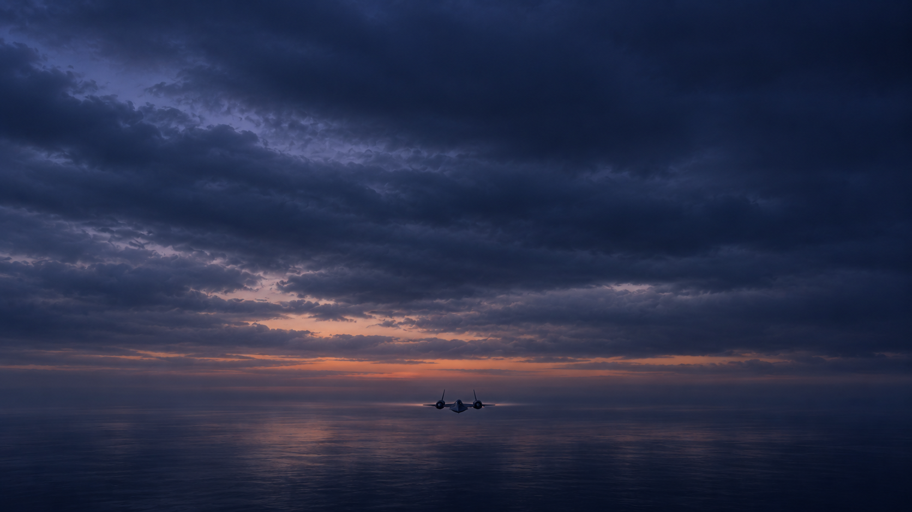
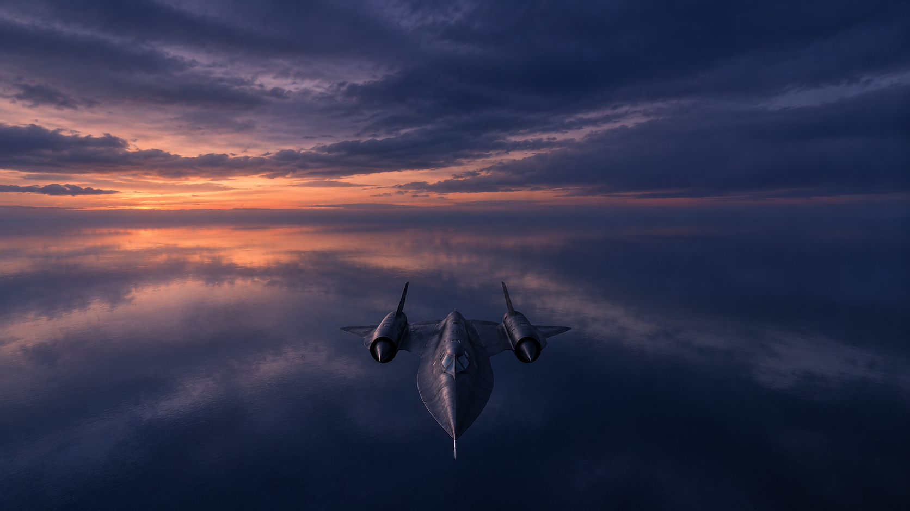
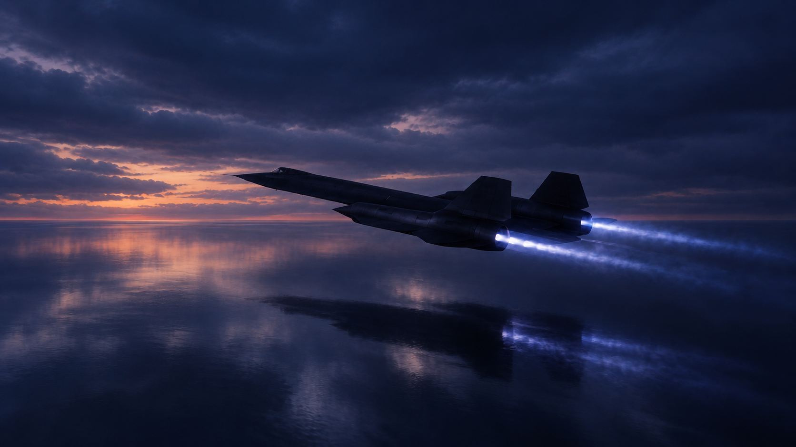

# SR-71 directing board — twilight climb

October 4, 2026. Working proposal, not a locked sequence. The racing-style generated video is rejected: sideways-looking flight and incoherent movement do not represent the intended shot. No new video generation is authorized or submitted. The latest stills are composition studies; the interactive 3D blockout is our discussion tool.

## Shared language and working method

**Camera blocking** plans where the camera and aircraft are and how they move relative to each other. **Camera path / trajectory** describes the route through space. **Timing and easing** describe when movement starts, accelerates, slows, and settles. **Framing** describes where the aircraft sits in the image and how large it appears. **Previs** is a rough visualization of the proposed shot; an **animatic** plays storyboard frames over time to test pacing. These are related artifacts, not interchangeable terms. [StudioBinder's camera-blocking workflow](https://www.studiobinder.com/storyboard-blocking/), [storyboard movement and arrows](https://www.studiobinder.com/blog/storyboard-arrows-meaning/), and [Adobe's storyboarding overview](https://www.adobe.com/uk/creativecloud/animation/discover/animation-storyboarding.html) support borrowing this approach.

Use the [3D directing room](storyboards/sr71-directing.html) to review the actual projected shot, then switch to Scene / paths to orbit around the camera and aircraft trajectories. The Storyboard tab collects all six generated stills, the original Blender blockouts, and browser-saved captures. This is a basic original SR-71 proxy, not a flight-accurate aircraft or a final environment render.

Review one variable at a time: camera height first, then distance/aircraft size, then the side-track hold, then lag during the climb, then rear catch-up, finally the light transition. Say “Beat 2: camera higher; same lens and aircraft path” rather than just “more epic.” Capture selected frames, add a shot note, and export the PNG plus its settings JSON alongside the notes if a setting feels promising. Captures retain their exact progress and settings and can restore the shot from the gallery.

## Visual direction

Blue-purple and indigo remain dominant. A subdued orange/peach afterglow sits near the distant horizon and softly reaches the water. This is after sunset, not bright stormy daytime. Clouds should be broad, smooth, layered masses with soft depth, avoiding boiling/cauliflower texture. Matte near-black aircraft, soft reflection, cold white-blue exhaust. Keep the intro entirely wordless; labels in the planning tools are discussion aids.

The camera starts substantially above the water, above the aircraft's low flight path, farther away. Aim approximately forward with a gentle downward angle; do not turn it into a steep bird's-eye shot. Aircraft placement low in the frame is separate from camera altitude. Raising the camera alone does not guarantee a smaller aircraft: increase distance too, and review lens/aim independently.

## Beat 1 — distant approach

Aircraft small and low in a huge twilight sky, racing forward close to the water. Camera high ahead, slightly off-axis if useful, looking back toward the approaching nose. Let the world feel still before the speed becomes obvious.

## Beat 2 — nose becomes significant

Aircraft grows while staying below the camera. Keep the high viewpoint; do not descend to the water or pass beneath it. The nose becomes legible before the camera moves over and out to the side. The current still is a framing proposal, not an exact camera match: its downward view is stronger than the near-level aim we may want.

## Beat 3 — side-track hold

Move over the upper nose/wing line and laterally into a slightly elevated side/three-quarter view. The aircraft keeps flying forward along its longitudinal axis; it never translates sideways. Match its forward speed briefly so the relative aircraft frame settles while water passes underneath.

This is the preferred angle/palette direction, not necessarily the final image. The aircraft remains low over the water during this beat.

## Beat 4 — pitch into climb; camera lags

The aircraft pitches its nose upward and its actual flight path begins climbing, rather than merely rotating while traveling horizontally. Camera temporarily holds its height/pace and stops perfectly matching the aircraft, letting it rise away in frame. Ease into pitch and climb; avoid an abrupt heading flip.

## Beat 5 — arc behind and above

The camera accelerates into a broad arc behind the aircraft, remaining above its path. Rotate the camera's gaze independently to acquire the rear. This is a tracking/orbit move plus a pan/tilt of the view, not merely a “pan” (which changes aim without moving the camera through space). Aircraft forward heading remains coherent.

## Beat 6 — rear catch-up

Briefly align behind the climbing aircraft. Now close the distance smoothly so the paired exhausts grow. The camera must catch up faster than the aircraft during this stylized move; simply continuing to lag would make the exhausts smaller. Alternative for review: keep physical distance steady and use a lens push/bloom transition. The current sketch proposes catch-up; this is not yet selected.

## Beat 7 — light fills the view

Afterburner light blooms into a soft white/blue-purple gradient, with a hint of warm afterglow at the edges if useful. Let the recognizable plane dissolve only near the end. The glow becomes the transition surface; the handoff into site content is still open. The sketch's fade swatch is a transition idea, not a simulated lens effect.

For the eventual transition into the main site, see the [spectral flight styling references](concepts.md#final-page--transition-into-the-main-site--spectral-flight-references) added October 7, 2026: cobalt fields, dark silhouettes, widening light trails and iridescent ribbons. These inform the ending surface; the camera sequence remains open.

## Blocking and easing proposal

| Beat | Aircraft action | Camera translation | Camera aim / framing | Timing feel |
| --- | --- | --- | --- | --- |
| 1 | Fast, level, near water | High, ahead; little initial motion | Gentle downward look; tiny plane low | Patient anticipation |
| 2 | Closes distance | Retreat, then rise/slide toward side | Upper nose visible; avoid underside | Acceleration with a smooth onset |
| 3 | Continues level | Matches forward speed at side | Whole-aircraft three-quarter view | Brief stable hold |
| 4 | Nose pitches up, path climbs | Maintains pace/height briefly | Plane rises and recedes | Gentle climb, visible camera lag |
| 5 | Continues climb | Arc to rear, then increase speed | Rear acquired without heading discontinuity | Fast but eased handoff |
| 6 | Climbs forward | Close gap, remain above | Exhausts grow | Controlled catch-up |
| 7 | Continues beyond readable image | Motion ceases to be legible | Palette-matched glow fills frame | Soft transition |

No exact shot duration is chosen. The sketch uses a **12-second illustrative timing**, adjustable; it is not a request to generate another 12-second clip. Beat lengths and dimensions are arbitrary normalized values, not meters, lens measurements, or aviation performance estimates. The height slider controls world height; the two diagrams show paths rather than a camera projection. Tracking softness delays camera motion independently of the aircraft. The side-hold control gives us a direct way to compare more or less breathing room.

## Decisions to review together

- How high should the camera feel while its gaze remains almost level?
- How much of the nose should enter before the move into side tracking?
- How long should the side-tracking composition settle before pitch-up?
- Should the rear transition be a continuous arc or a motivated cut hidden by motion/glow?
- Should exhaust growth come from catch-up, a lens push, bloom, or a combination?
- Should the ending go nearly white, or retain blue-purple and peach throughout?

## Sources and provenance

Original supplied [poster](inspo/sr71-metal-print-reference.png) and [blue-hour screenshot](inspo/sr71-blue-hour-afterburners.png); [earlier stills](storyboards/stills/README.md); [film/flight research](jet-shot-references.md). The three new stills use the built-in GPT Image tool; [exact edit prompts](prompts/sr71-elevated-twilight-stills.md). They preserve earlier files as separate versions. No Blender reference was used. A single AI generation per composition does not validate aircraft geometry or motion continuity, and the image tool returned no billing receipt.

## 3D directing room — controls and persistence

The supplied [Had camera preset](storyboards/presets/had-camera-settings.json) is versioned unchanged: height 28, side hold 2.5 seconds, softness 0.6, duration 8 seconds, progress 0. The old schematic used a different spatial scale; these values now seed an original 3D blockout with new lens and distance defaults, rather than promising an exact match to the old 2D diagram.

- **Shot**: actual perspective camera; scroll over the picture to scrub, drag the progress slider, use arrow keys, jump to beats, or play once.
- **Sidebar**: starting height; field of view; vertical aim bias; front, side, and rear distances; side height; above-aircraft clearance; flight altitude/speed/climb; hold, duration, softness and easing; grid, clay, and light controls. Each has a numeric field as well as a slider where applicable.
- **Scene / paths**: drag to orbit, wheel to zoom. Peach is aircraft path, lavender is camera path; the camera frustum is drawn only 90 relative units deep for readability. Use the timeline here to inspect the move in space.
- **Capture this frame**: records a clean 1600 × 900 shot with progress, settings, and camera/aircraft pose. Planning labels and the sidebar are excluded. Even from the scene view, capture records the shot camera.
- **Storyboard**: browse reference studies and captures; open a capture to restore its configuration, edit its note, or download its PNG and JSON.

Current controls are saved in localStorage and captured frames in IndexedDB on this browser origin. They survive a reload but are not automatically committed to Git. Download selected captures and put them under `notes/storyboards/` to version them. Opening the tool at another host/port or clearing browser storage creates a separate or empty capture library. The repo-backed reference studies and imported preset remain available.

Softness filters camera offsets in seconds with a deterministic time step, so scrubbing backward produces the same pose as moving forward. The aircraft travels nose-forward along −Z, with pitch derived from its rising flight path. A minimum clearance keeps the camera above the aircraft; this can override requested absolute camera height during the climb. The side hold timing is exact, but softness can make the camera continue settling at its beginning. All distances and speeds are relative blocking units, not meters or real SR-71 performance. The light transition is an overlay; the environment uses a simple twilight gradient and grid, not a cloud/water simulation.

The renderer is pinned to [Three.js](https://threejs.org/docs/) 0.186.1, vendored locally with its MIT license. There is no build step or runtime CDN dependency. Start from the repo root with `python3 -m http.server 8766 --bind 127.0.0.1` and open `http://127.0.0.1:8766/notes/storyboards/sr71-directing.html`. Validate the camera path with `node notes/storyboards/sr71-path.test.mjs`.

## October 7 revision — closing approach and phase controls

Had requested an additional opening: an almost invisible distant aircraft, with both the camera and aircraft rushing toward each other. The 3D tool now has eight annotated phases. The new opening defaults to 1,800 relative units of front separation, a 2-second approach, camera rush 500 and aircraft approach 280 relative units/second. The camera's closing move starts fast and brakes toward the nose reveal when easing is enabled. The aircraft's opening speed blends into the subsequent tracking speed over 0.4 seconds. The model limits requested closing speeds if they would cross the aircraft before the next phase; the readout identifies this case.

The new approach adds two seconds to a migrated browser preset's total duration (the old 8-second clip becomes 10 seconds). Existing height, lens, side, climb and other controls are retained. The original imported JSON remains unchanged. New exports are version 2; older settings and browser captures are accepted with new approach defaults, so their stored images remain valid references but restoring an old capture does not reproduce the former seven-phase path exactly.

The scrubber has a duration-proportional phase strip with labels, exact time ranges, an active-phase highlight and a playhead. Click a phase to jump to its beginning. The sidebar automatically shows that phase's relevant controls; whole-clip duration, flight altitude and display toggles live in a collapsed section. Lens, vertical aim, softness and easing remain shared parameters wherever shown, rather than independent per-phase lens keyframes.

At extreme timing settings the tool reserves at least 1.5 seconds for the other six phases and shortens the opening if necessary. The side hold retains its requested duration within the allowed controls. No image/video generation was submitted for this revision.
