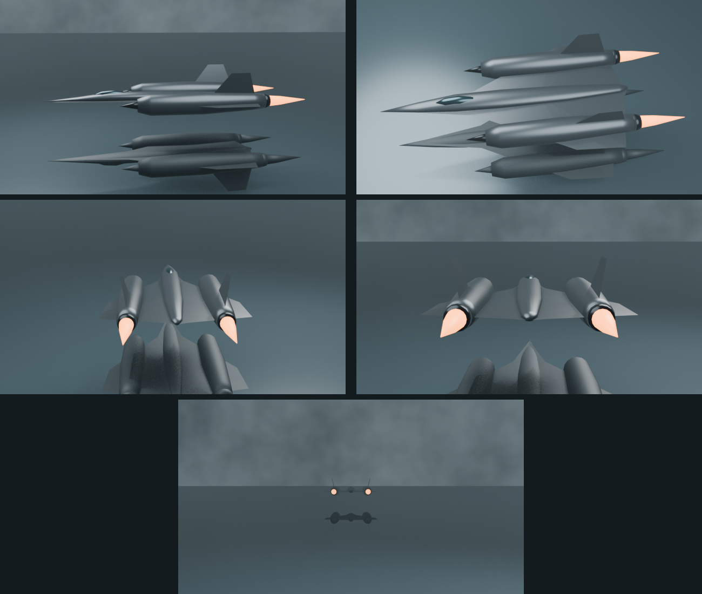
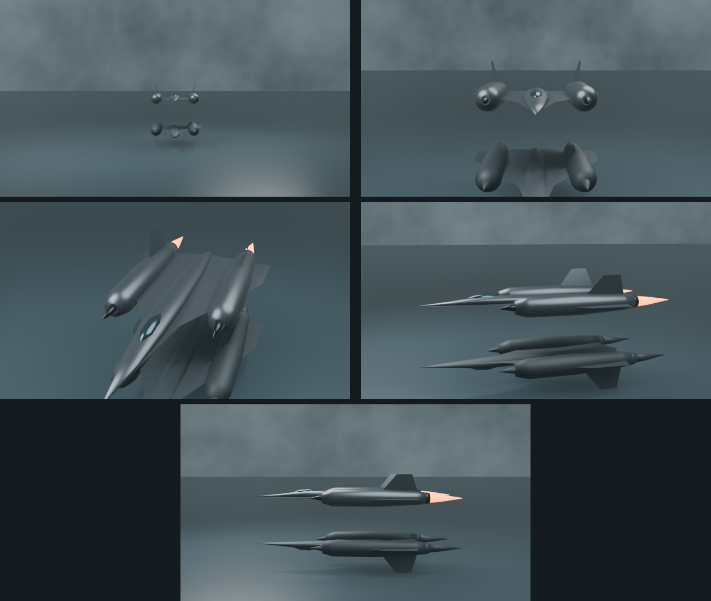

# SR-71 camera storyboards

October 4, 2026. Two alternative routes, blocked with original, simple aircraft geometry in Blender. These are camera/composition studies, not an accurate production SR-71 model or a finished environment. Read each sheet left to right, then down; the fifth frame is centered at the bottom. There are no captions inside the frames.

Current scope: storyboarding first. Choose the shot sequence before spending time on a detailed aircraft, a final horizon, or continuous animation.

## Route A: follow, climb, settle behind, depart

1. **Side follow.** Travel alongside the aircraft over the water. Establish the silhouette and its reflection; the plane is already under power.
2. **Climb over the wing.** Move up and across the aircraft so its long spine and twin nacelles become legible. The camera motion should feel continuous, not like a cut.
3. **Settle behind.** Rotate into a rear view as the camera drops back toward the water. Keep the aircraft ahead of the viewer.
4. **Afterburners toward the viewer.** Hold a symmetrical rear composition. Two exhausts dominate the near side of the aircraft; their warm light is the only strong color accent.
5. **Departure.** Let the camera fall behind while the aircraft accelerates toward the horizon. It shrinks into the haze, leaving the scene quiet.

This ending emphasizes speed, distance, and release. It needs a decision about what the empty horizon becomes afterward.

## Route B: head-on approach, retreat and rise, poster reveal

1. **Distant nose.** A small, nearly symmetrical shape hangs against the storm. Generous empty sky and water give it scale; the aircraft is an object to discover.
2. **Approach.** The aircraft grows toward the camera, remaining close to the center. Its identity becomes clear gradually.
3. **Retreat and rise.** As it closes the gap, the camera accelerates backward and moves above and slightly to one side. The overhead view in this frame is a spatial waypoint; the speed match and continuity still need an animation pass.
4. **Side reveal.** Arc onto the side while easing the camera's relative motion. The reflection helps the viewer stay oriented through the rotation.
5. **Poster composition.** Settle into a restrained profile with the nose pointing left, water/reflection below, and storm above. Hold here rather than sending the aircraft away.

Working preference: start by refining Route B. It turns the poster into a destination and provides a composed resting state for a site. Route A remains an alternative; combining both would add another ending and is not yet a decision.

## Horizon and atmosphere still to explore

- Low, diffuse cloud ceiling over a barely visible ocean horizon.
- A near-seamless sky/water boundary, with the reflection supplying orientation.
- A faint brighter opening on the nose side, borrowing the poster's directional light.
- Cold slate, blue-gray haze, matte graphite metal, minimal saturation, and grain, as in the saved moody desktop references.

The current noise-based sky, straight water horizon, and mirrored proxy are compositional placeholders. The mirror is manually duplicated aircraft geometry, not simulated water optics. Do not carry their appearance into the final scene by default. Afterburner shapes are simple emissive cones; they are not final exhaust effects.

## Model candidates

Research listings checked October 4, 2026. Neither model has been downloaded or incorporated. The Sketchfab search listings were accessible; direct model-page fetches returned 403, so inspect the downloadable files and current terms before production use.

- [Tyler Nichols — SR-71 Blackbird](https://sketchfab.com/3d-models/sr-71-blackbird-40794825d2f64a6ca945990c8ff1e90f): listed as downloadable, untextured, built from blueprints, uploaded with Blender, approximately 185,900 triangles, CC Attribution. A possible detail-model starting point after the shot works.
- [helijah — Lockheed SR-71 Blackbird](https://sketchfab.com/3d-models/lockheed-sr-71-blackbird-1850c7bb7ac54902bd9868381ff8b652): listed as downloadable, approximately 69,100 triangles, Free Standard license. A lighter candidate; retain the exact license terms when choosing an asset.

For an offline-rendered introduction, the source model's triangle count does not directly become the browser payload. Camera coverage, rendered-frame count, resolution, compression, and the handoff to the live page determine the eventual delivery size.

## Editable blockout and reproduction

- [Head-on route / default scene](storyboards/sr71-blockout.blend): opens at Route B's first shot. Both cameras are included. Frames 1, 49, 97, 145, and 193 contain the shot poses.
- [Rear-chase route](storyboards/sr71-route-a.blend): includes the departure translation and defaults to Route A's camera.
- [Blender source](storyboards/sr71-blockout.py): original geometry, camera poses, lighting, and renders. Run from the repository root with `blender -b --python notes/storyboards/sr71-blockout.py`.
- [Contact-sheet assembly](storyboards/assemble.py): requires Pillow; run with `python3 notes/storyboards/assemble.py` after rendering.

The pose keyframes are a starting point for editing, not a reviewed continuous camera animation. Geometry accuracy, camera easing, relative aircraft speed, storm lighting, and the page transition remain open.
