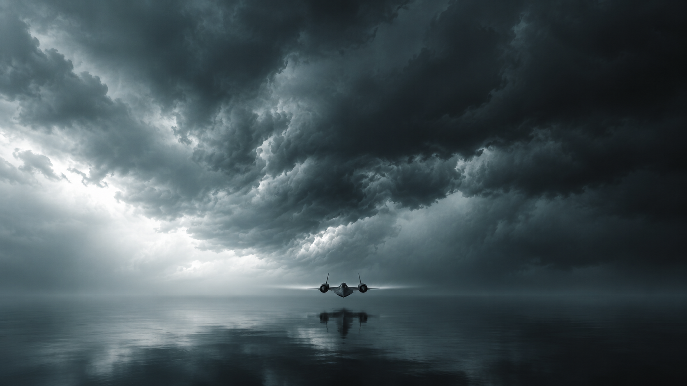
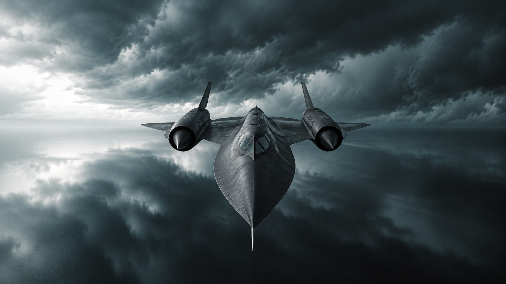
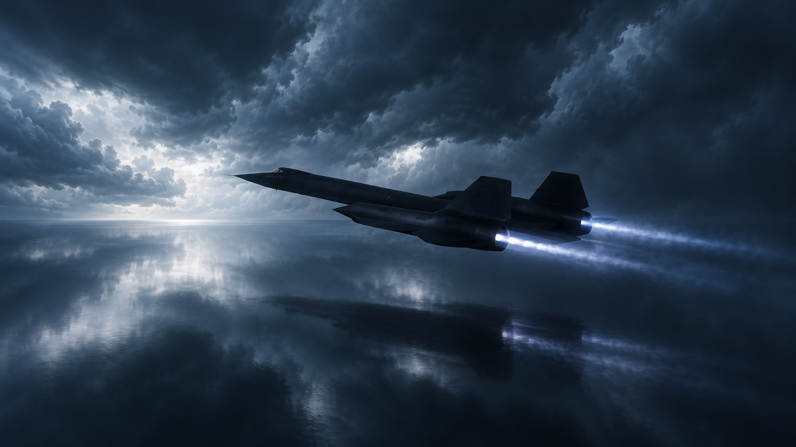

# SR-71 still studies

## Latest revision — elevated twilight approach

The latest [directing board](../../sr71-directing-board.md) uses [distant elevated twilight](04-distant-elevated-twilight.png), [elevated nose approach](05-nose-elevated-twilight.png), and [twilight side view](06-side-twilight.png). These add blue-purple dusk, subdued orange afterglow, smoother cloud masses, and higher/farther cameras in the first two. Earlier images below are retained for comparison. [Exact revised prompts](../../prompts/sr71-elevated-twilight-stills.md).

Generated October 4, 2026 with the built-in GPT Image tool, as three independent composition studies. [Exact prompts](../../prompts/sr71-stills.md). These are AI-created reference images, not anatomically validated aircraft renders or proof of a continuous camera move.

## 1. Distant approach

Small head-on aircraft placed low beneath a large storm ceiling. Original poster controls atmosphere and aircraft identity.

## 2. Close nose before the camera rises

Aircraft nose and cockpit dominate the foreground; the elevated camera shows upper surfaces and establishes the desired move over the plane. This angle is more elevated than the distant view and can help explore the handoff. Preserve the direction, then refine exact camera height after review.

## 3. Wider blue-influenced ending

Poster-like storm texture and dark metal, combined with the supplied blue-hour screenshot's broad three-quarter angle and white-blue exhaust. Pulled back to leave room around the entire aircraft. This is a possible ending composition rather than a prescribed final frame.

